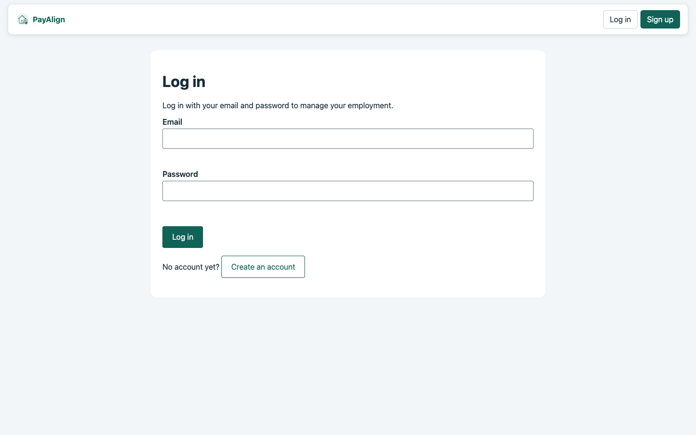
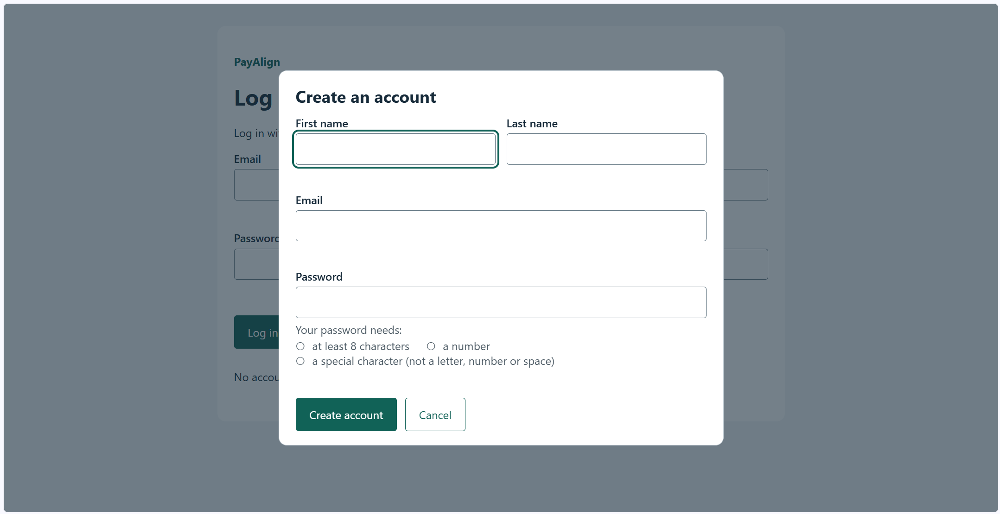
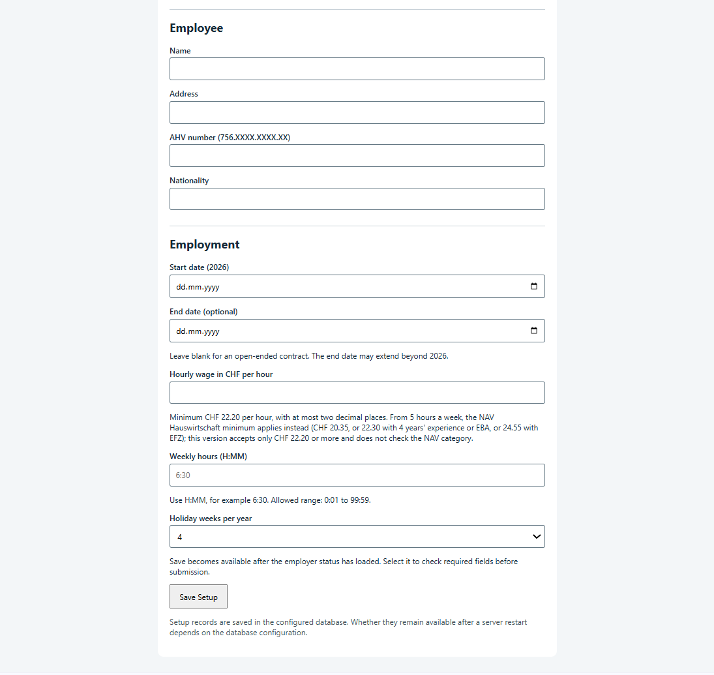
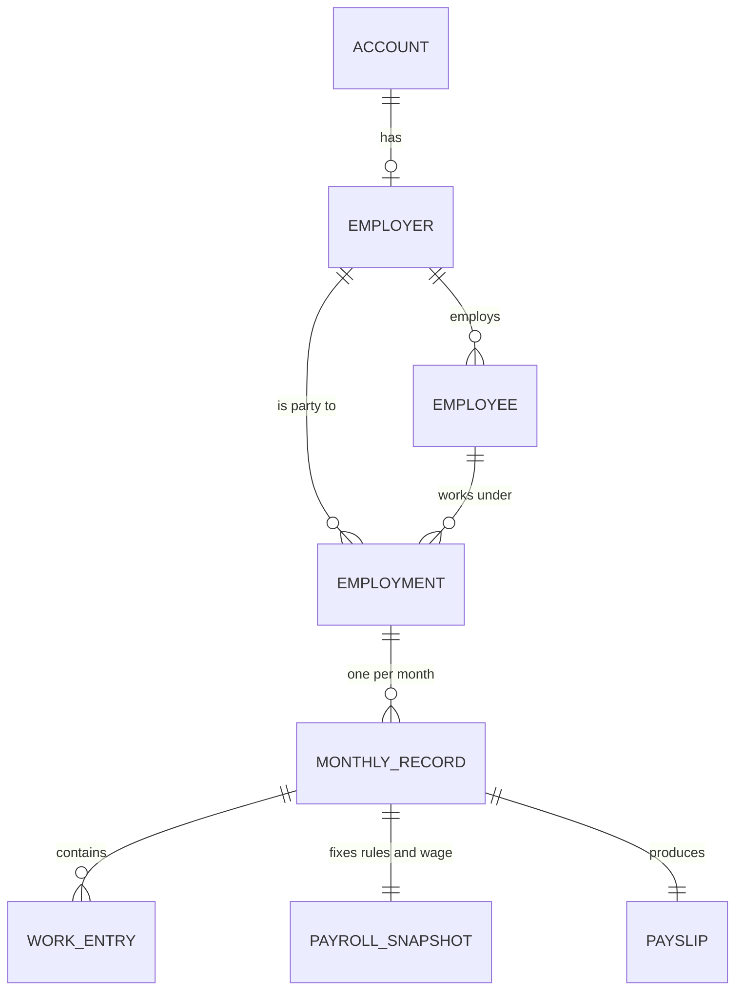

# PayAlign

[](https://github.com/Guin-Kiwi/pay-align-dev/actions/workflows/ci.yml)
[](LICENSE)

PayAlign is a payroll application for private household employers in Basel-Stadt
who use the AKBS simplified settlement procedure. An employer creates an account,
sets up an employment, enters the days worked each month and receives a payslip
with social insurance and tax deductions at the 2026 rates.

- **Live demo:** <https://pay-align-dev.onrender.com/login> (free Render instance; the first request can take a minute while it starts)
- **API documentation:** <https://pay-align-dev.onrender.com/docs>
- **Capstone project** for the FHNW module AI-assisted Software Development, built from the [AI-SDLC template](https://github.com/AIaSDev/ai-sdlc-template)

## Problem

Employing a cleaner or other household help in Basel-Stadt makes a private person
an employer. Every month they must calculate the gross wage, deduct AHV/IV/EO, ALV,
NBU and withholding tax, pay the employer contributions, track holiday entitlement
and stay within the annual limits of the simplified procedure. The rules are
published in the [AKBS guide](docs/reference/Employing_Household_Help_Basel.pdf) and a
[payslip workbook](docs/reference/Payslip_2026.xlsm), but applying them by hand is
error-prone, and HR software is built for companies.

**Target users:** private households who want to employ individuals directly for household help directly in Basel-Stadt.

**Scenario:** an employer registers, sets up an employment for their cleaner (hourly
wage, weekly hours, holiday weeks), and at the end of each month enters the days
worked. PayAlign calculates the month, checks it against the annual limits, saves it
and returns the payslip. Saved months cannot be changed.

PayAlign covers private household employment under the simplified procedure only.
Company payroll, the ordinary procedure and exception cases such as sick pay are out
of scope (see [Known limitations](#known-limitations-and-deferred-decisions)).

## What PayAlign calculates

For each month, PayAlign:

- **Works out the gross wage** from the daily work entries: hours worked, paid annual
  holiday, paid public holidays, a 50% premium for hours worked on a public holiday, and
  any cash bonus. Expense reimbursements are kept out of the gross wage.
- **Deducts the employee contributions:** AHV/IV/EO, ALV, the simplified-procedure tax,
  and non-occupational accident insurance (NBU) when the contract has enough weekly hours.
- **Adds the employer contributions:** AHV/IV/EO, ALV, family allowances (FAK),
  occupational accident insurance (BU) and the AKBS administration charge.
- **Calculates the net payout** (gross wage minus deductions, plus reimbursements) and the
  employer's total cost for the month.
- **Tracks holiday entitlement:** a yearly entitlement in minutes, pro rata for part-year
  employments, reduced by each month's holiday taken. A month that would take the balance
  below zero is rejected.
- **Checks the annual limits:** a month is rejected if it would take the employee's or the
  employer's total gross wage for the year above the simplified procedure's limits.

At setup, the hourly wage is checked against a minimum of CHF 22.20 (see
[Known limitations](#known-limitations-and-deferred-decisions)). Rates, limits
and thresholds are defined once in [`constants.py`](src/app/domain/constants.py), and the
formulas are in [calculations.md](docs/reference/calculations.md). The golden test cases
come from the AKBS payslip workbook.

## Use cases

| Use case | What it does | Service |
|---|---|---|
| [UC-001 Set up an employment](docs/specs/UC-001-Set-Up-an-Employment.md) | Saves the employer, the employee and the employment terms, with a minimum hourly wage of CHF 22.20 | [`SetupService`](src/app/application/setup_service.py) |
| [UC-002 Process the monthly employment](docs/specs/UC-002-Process-the-Monthly-Employment.md) | Calculates one month from the daily work entries and saves the entries, a run snapshot, the monthly record and the payslip in one transaction | [`PayrollService`](src/app/application/payroll_service.py) |
| [UC-003 Employer accounts and secure access](docs/specs/UC-003-Employer-Accounts-and-Secure-Access.md) | Registration, login and logout, signed session cookies, CSRF protection, and reads scoped to the signed-in account | [`AccountService`](src/app/application/account_service.py), [`EmploymentReadService`](src/app/application/employment_read_service.py), [`EmployeeOverviewService`](src/app/application/employee_overview_service.py) |
| [UC-004 UI and user flow](docs/specs/UC-004-UI-AND-USER-FLOW.md) | The browser journey from sign-in through setup and monthly payroll to a printable payslip; it uses the services above and adds no payroll rules | — |

The run order, empty months, daily entries and public holidays are specified in
[UC-002](docs/specs/UC-002-Process-the-Monthly-Employment.md). The browser views are defined in
[UC-003 Amendment 3](docs/specs/UC-003-Employer-Accounts-and-Secure-Access.md#amendment-3--2026-10-23-minimum-browser-views)
and [UC-004](docs/specs/UC-004-UI-AND-USER-FLOW.md):

| Page | What the employer does there |
|---|---|
| `/` | Welcome page with sign-in and registration |
| `/login` | Sign in, or create an account |
| `/employer-setup` | Enter or change the employer's own details |
| `/employments` (Home) | See the household wage limit, this month's costs and what is due |
| `/setup` | Add an employment |
| `/timesheets` | Enter a month: fill a weekly pattern, add extra days and holidays, review and save |
| `/employees` | See each person's employments, totals, holiday balance and wage limit |
| `/payslips` | Open a saved payslip and print it or save it as a PDF; employer costs are shown on screen only |

### Screenshots

**Login and registration**




**Employment setup**



**Payslip**

<!-- add monthlyentry.png and payslip.png,  then uncomment.


-->

## Course requirements

| Requirement | Where it is met |
|---|---|
| Enterprise-grade layered architecture | Domain, Application, Interfaces and Infrastructure layers with dependencies pointing inward: [PROJECT.md: Architecture](docs/PROJECT.md#architecture), [ADR-001](docs/adr/ADR-001-clean-architecture-boundaries.md) |
| Business logic separate from framework code | Payroll rules and entities in [`src/app/domain/`](src/app/domain/) import no framework or database code; [`test_architecture.py`](tests/unit/test_architecture.py) checks the import direction between layers |
| Spec-driven development / AGENTS.md | Every use case has a spec with acceptance criteria and a validation plan before any code is written ([specs](docs/specs/)); consequential decisions are recorded as ADRs ([ADRs](docs/adr/)); agents follow [AGENTS.md](AGENTS.md) and the [phase skills](skills/); [TASKS.md](docs/TASKS.md) holds the current phase and open work |
| At least five entities | Seven domain entities (Account, Employer, Employee, Employment, MonthlyRecord, WorkEntry, Payslip), persisted in eight tables with the run snapshot ([Data model](#data-model)) |
| At least two use cases as services | Three use cases, each implemented as an application service that depends only on ports: `SetupService` (UC-001), `PayrollService` (UC-002) and `AccountService` (UC-003), in [`src/app/application/`](src/app/application/) |
| Relational database with ORM | SQLAlchemy models with foreign keys and unique constraints ([`orm_models.py`](src/app/infrastructure/orm_models.py)); SQLite for local runs and tests, PostgreSQL in production; CI runs the database tests on both ([ADR-005](docs/adr/ADR-005-sqlalchemy-persistence-adapter.md)) |
| Test-driven development | Tests written first and committed as RED, then GREEN; each spec's Validation plan maps acceptance criteria to tests ([UC-002](docs/specs/UC-002-Process-the-Monthly-Employment.md#validation-plan)); golden cases from the AKBS workbook in [`payroll_golden_cases.json`](tests/fixtures/payroll_golden_cases.json) |
| CI/CD | Every pull request runs the full test suite on SQLite and PostgreSQL ([CI](.github/workflows/ci.yml)); a `v*` tag builds and checks the Docker image, publishes a GitHub release ([release](.github/workflows/release.yml)) and deploys that commit to Render, followed by a smoke test ([CD](.github/workflows/cd.yml)) |
| Active use of a coding agent | Agents wrote code, tests and documents under human review; each agent commit names its model ([AI assistance](#ai-assistance)) |

## Architecture

```mermaid
flowchart LR
    Browser["Browser<br/>/login, /employments, /timesheets, /payslips"] --> Interfaces
    subgraph Infrastructure["Infrastructure: FastAPI app, SQLAlchemy, Argon2, sessions"]
        subgraph Interfaces["Interfaces: routes, request/response models, auth, CSRF"]
            subgraph Application["Application: services and ports"]
                Domain["Domain: entities, 2026 AKBS rules"]
            end
        end
    end
    Infrastructure --> DB[("SQLite / PostgreSQL")]
```

Each layer may depend only on the layers inside it:

- **Domain** holds the entities (Account, Employer, Employee, Employment, MonthlyRecord,
  WorkEntry, Payslip), value types such as the AHV number, and the 2026 AKBS payroll
  rules: gross-to-net calculation, holiday balance and annual-limit checks. It imports no
  framework or database code.
- **Application** holds the use-case services (`SetupService`, `PayrollService`,
  `AccountService`, `EmploymentReadService`) and the ports they need: repository
  interfaces and a password-hasher interface.
- **Interfaces** holds the FastAPI routes, request and response models, the session
  check and CSRF validation, and the browser pages.
- **Infrastructure** implements the ports with SQLAlchemy repositories and an Argon2
  password hasher, and wires the app together: database connection, signed session
  cookies and the web server.

Because the services depend on ports rather than SQLAlchemy, the payroll logic is unit
tested without a database. [`test_architecture.py`](tests/unit/test_architecture.py)
checks the import direction between the layers (see
[Known limitations](#known-limitations-and-deferred-decisions)). The decisions behind the
structure are recorded as ADRs:

| ADR | Decision |
|---|---|
| [ADR-000](docs/adr/ADR-000-python-as-project-language.md) | Python as the project language |
| [ADR-001](docs/adr/ADR-001-clean-architecture-boundaries.md) | Clean Architecture boundaries |
| [ADR-002](docs/adr/ADR-002-versioned-akbs-payroll-rules.md) | Versioned AKBS payroll rules |
| [ADR-003](docs/adr/ADR-003-monetary-precision-and-rounding.md) | Monetary precision and rounding |
| [ADR-004](docs/adr/ADR-004-payroll-entry-snapshots-and-holiday-balance.md) | Payroll entry snapshots and holiday balance |
| [ADR-005](docs/adr/ADR-005-sqlalchemy-persistence-adapter.md) | SQLAlchemy persistence adapter |
| [ADR-006](docs/adr/ADR-006-uc-001-setup-api-and-wiring.md) | UC-001 setup API and wiring |
| [ADR-007](docs/adr/ADR-007-employer-accounts-and-secure-access.md) | Employer accounts and secure access |

Formulas are in [calculations.md](docs/reference/calculations.md), and every rate,
limit and threshold is defined once in [`constants.py`](src/app/domain/constants.py).

## Data model



An account has at most one employer. An employment belongs to one employer and one
of that employer's employees. A month can be saved once per employment, and its work
entries, run snapshot and payslip are saved with it in one transaction
([ADR-004](docs/adr/ADR-004-payroll-entry-snapshots-and-holiday-balance.md)). The
tables are defined in [`orm_models.py`](src/app/infrastructure/orm_models.py).

## API

| Method | Path | Purpose |
|---|---|---|
| `POST` | `/api/v1/auth/register`, `/api/v1/auth/login`, `/api/v1/auth/logout` | Account and session ([UC-003](docs/specs/UC-003-Employer-Accounts-and-Secure-Access.md)) |
| `GET` | `/api/v1/auth/me`, `/api/v1/auth/csrf` | Current account and CSRF token |
| `GET`, `POST`, `PUT` | `/api/v1/employer` | Read, create or update the signed-in account's employer |
| `POST` | `/api/v1/setup` | Set up an employment ([UC-001](docs/specs/UC-001-Set-Up-an-Employment.md)) |
| `POST` | `/api/v1/monthly-payroll` | Calculate and save a month ([UC-002](docs/specs/UC-002-Process-the-Monthly-Employment.md)) |
| `GET` | `/api/v1/employments`, `/api/v1/employments/{id}` | The account's employments |
| `GET` | `/api/v1/employments/{id}/months`, `/api/v1/employments/{id}/months/{year}/{month}` | Saved months and payslips |
| `GET` | `/api/v1/employees`, `/api/v1/employees/{id}` | Overview per person (totals, holiday balance, wage limit) and one person's details |
| `GET` | `/api/v1/payroll-overview?year=&month=` | The household's saved payroll for one month |
| `GET` | `/api/v1/public-holidays?year=`, `/api/v1/public-holidays/{year}` | The configured 2026 public holidays |

State-changing requests need a signed-in session and an `X-CSRF-Token` header. The
full schema is at `/docs` on a running instance.

## Technology

| Area | Choice |
|---|---|
| Language | Python 3.12 |
| Web framework and validation | FastAPI, Pydantic |
| ORM and databases | SQLAlchemy; SQLite locally, PostgreSQL (psycopg 3) in production |
| Security | Argon2 password hashing (pwdlib), signed session cookies (Starlette, itsdangerous), CSRF tokens |
| Browser UI | HTML, CSS and JavaScript served by FastAPI |
| Testing | pytest and httpx; Node.js 22 runs the browser-page tests |
| Delivery | Docker, GitHub Actions, Render |

## Running and testing

**Prerequisites:** Docker for running the app; Python 3.12 and Node.js 22 for running
the tests outside the container. The dev container installs Python and Node.js.

1. Clone the repository: `git clone https://github.com/Guin-Kiwi/pay-align-dev.git`
2. Set `SESSION_SECRET_KEY` in `.env` to a random value:
   `python -c "import secrets; print(secrets.token_urlsafe(32))"`
3. Build the image with `docker compose build api`. On the first run, give the app's
   user the local data folder:
   `mkdir -p data && docker compose run --rm --no-deps --user root --entrypoint chown api -R 10001:10001 /app/data`
4. Start the app with `docker compose up api` and open <http://localhost:8000>.
   `curl http://localhost:8000/health` should return `{"status":"ok"}`.
5. Optional demo data (empty local database, app running): `python3 scripts/seed_demo.py`,
   then log in as `demo@example.com` / `demo-pass1`. One employment is up to date, one has
   months due.
6. For the tests, create a virtual environment and install the locked dependencies:
   `python3.12 -m venv .venv && .venv/bin/python -m pip install --require-hashes --only-binary=:all: -r requirements-dev.txt`
7. Run every check with `bash scripts/test.sh`.

Environment variables, the PostgreSQL test setup and the release image are described in
[PROJECT.md: Commands](docs/PROJECT.md#commands).

Tests are split into [unit](tests/unit/) (domain and application, no database),
[integration](tests/integration/) (database adapters, API and UI) and
[end-to-end](tests/e2e/) (the demo flow against a running server, and the Docker image).
PostgreSQL tests run when `TEST_POSTGRES_URL` is set; CI always runs them.

## Known limitations and deferred decisions

- **Simplified procedure only:** a month that would exceed an annual limit is rejected; the ordinary procedure is not supported.
- **No annual AKBS wage declaration** in v0.1.0; the saved months are kept for it.
- **Out of scope:** sick pay, accidents, property damage, disputes, terminations and account closure ([PROJECT.md: Purpose](docs/PROJECT.md#purpose)).
- **Payroll rules not applied:** the Sunday supplement, age-dependent AHV rules and the CHF 1,890 monthly limit ([UC-002: Known limitations](docs/specs/UC-002-Process-the-Monthly-Employment.md#known-limitations)).
- **Saved months are final:** corrections and reversals are not supported.
- **Minimum wage:** setup uses CHF 22.20 as a single wage floor. From 5 hours a week the NAV Hauswirtschaft minimums apply instead, so setup rejects some lawful wages from CHF 20.35 to 22.19 and does not check the higher minimums for trained or experienced staff ([UC-001](docs/specs/UC-001-Set-Up-an-Employment.md)).
- **Setup checks:** the employee's AHV number is not compared with the employer's, and the simplified procedure's exclusion of the employer's spouse and children is not checked ([UC-001](docs/specs/UC-001-Set-Up-an-Employment.md)).
- **Days off on one date:** the Timesheets page refuses two annual-holiday rows, or annual holiday and work, on the same date; the API itself accepts them, because UC-002 does not define them as invalid.
- **Holiday balance:** the remaining balance appears once the first month is saved; before that, the yearly entitlement is not shown.
- **Saved payslips:** a reopened payslip shows the current employer name and the current employee name and AHV number, not a copy from the day it was saved ([UC-003 Amendment 7](docs/specs/UC-003-Employer-Accounts-and-Secure-Access.md#known-limitations)).
- **No migrations:** `create_all` creates missing tables only, so the account-enabled schema needed a fresh database ([PROJECT.md: Architecture](docs/PROJECT.md#architecture)).
<!-- Add the browser views that are cut for v0.1.0 here once decided. -->

## AI assistance

PayAlign was developed with coding agents under the rules in [AGENTS.md](AGENTS.md):
specification before code, tests before implementation, small reviewable commits and
human approval for decisions. The work follows the template's six phases (Bootstrap,
Specify, Design, Develop, Validate, Deploy), each with a [phase skill](skills/), and
[TASKS.md](docs/TASKS.md) records where the project stands.

Agent-written commits name their model in an `Agent-Model` trailer, and human review
commits (`review: human review of …`) record what a person checked before approving.
Every pull request needs approval from someone other than its author. Models used include Claude
Sonnet 5.5, Claude Opus 5.5, GPT-6, GPT-5.6 Luna, Mistral Large 3 and GitHub Copilot.

## Team

Aaron Casula, Assvinth Mathikanthan, Ayla Allen and Nano
([@Gedance23](https://github.com/Gedance23)).

## Credits and licence

Application code and project documents: [MIT](LICENSE). Template material: "The AI-SDLC
Template and Method" by Andreas Martin and Sandro Schwander (FHNW), CC BY 4.0; see
[LICENSE](LICENSE), [CITATION.cff](CITATION.cff) and [TEMPLATE.md](docs/TEMPLATE.md).